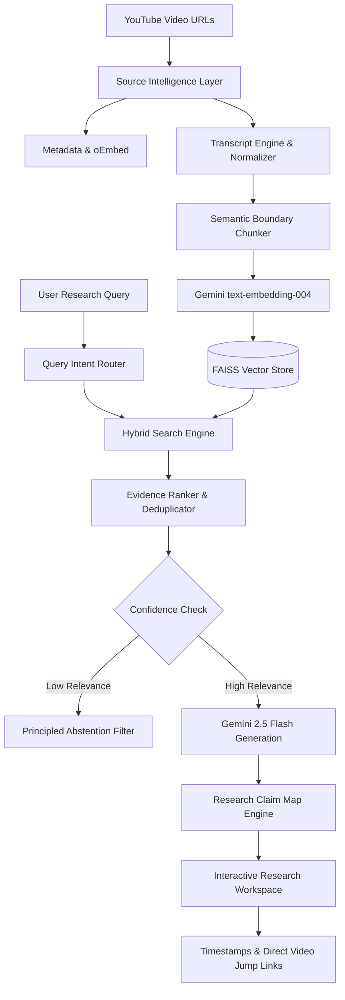

# 🧠 VideoMind AI
### Multimodal YouTube Research & Learning Copilot
*Turn YouTube videos into an evidence-grounded research and learning workspace.*

[](https://www.python.org/)
[](https://streamlit.io/)
[](https://ai.google.dev/)
[](https://github.com/facebookresearch/faiss)
[](tests/)
[](LICENSE)

---

## 📌 The Problem
Students, software engineers, and researchers consume hours of technical YouTube content (lectures, conference talks, programming tutorials), but suffer from severe pain points:
1. **Unsearchable Knowledge:** Video knowledge remains locked inside hours of linear footage.
2. **Hallucination-Prone AI:** Generic chatbots summarize videos by hallucinating facts, quoting imaginary lines, and inventing fake timestamps.
3. **No Cross-Source Comparison:** Comparing how three different professors explain a concept requires hours of manual cross-referencing.
4. **Disregard for Visual Artifacts:** Slides, whiteboard diagrams, and code snippets shown on screen are ignored by standard subtitle-only summarizers.

## 💡 The Solution: VideoMind AI
**VideoMind AI** is an evidence-first, multimodal research copilot that treats YouTube videos like verifiable academic papers.

It combines **hybrid dense-sparse retrieval (FAISS)**, **strict claim-to-evidence alignment**, **targeted multimodal video understanding**, and **cross-source synthesis** to provide a trusted research and study workspace.



---

## 🌟 Why VideoMind AI Is Different

| Baseline Market Chatbot | VideoMind AI Research Copilot |
| :--- | :--- |
| Blindly answers from general LLM training data | **Strictly grounds claims in retrieved video evidence** |
| Invents fake timestamps and imaginary quotes | **Verifies timestamps with direct clickable YouTube jump links** |
| Single-video chat window | **Cross-source comparative matrix (2–5 videos simultaneously)** |
| Ignores on-screen visuals | **Targeted multimodal inspection of slides, diagrams, and equations** |
| Hallucinates when missing information | **Principled Abstention Filter: says *"Not enough evidence"*** |
| Unformatted wall of text | **Claim Map: Breaks answers into atomic claims with provenance tags** |

---

## 🚀 Core Features (All 22 Implemented)

1. **Robust Video Ingestion:** Accepts standard, shorts, youtu.be, and embed URLs with input sanitization.
2. **Source Workspace:** Multi-video source sidebar with select/deselect, inspect, and removal controls.
3. **Boundary-Aware Semantic Chunking:** Groups subtitle cues by natural sentence boundaries while retaining exact start/end seconds.
4. **FAISS Vector Indexing:** Meta's `IndexFlatIP` performing exact cosine similarity search over 768-dim normalized embeddings.
5. **Hybrid Dense-Sparse Retrieval:** Balances dense semantic similarity with sparse lexical keyword matching ($\alpha = 0.65$).
6. **Evidence-Grounded Research Chat:** Answers queries with labeled confidence strength (`High`, `Medium`, `Low`).
7. **Targeted Multimodal Understanding:** Cost-aware visual inspection of diagrams and slides at specific timestamps.
8. **Collapsible Evidence Cards:** Displays exact source excerpts, relevance scores, and jump links.
9. **Research Claim Map:** Maps atomic factual claims to specific chunk IDs, tagging statements as `[SUPPORTED BY SOURCE]`, `[INFERENCE]`, or `[GENERAL KNOWLEDGE]`.
10. **Multi-Video Comparison Matrix:** Generates structured comparative tables across 2 to 5 videos on rigor, depth, and pedagogical approach.
11. **Disagreement Detector:** Detects whether differing explanations represent genuine contradictions, terminology nuances, or depth variations.
12. **AI Study Lab:** One-click study pack generation (Summary, Concepts, Definitions, Formulas, Common Pitfalls, Interview Questions, Revision Checklist).
13. **Adaptive Explanations:** Explains concepts tailored to Beginner (Intuition), Intermediate (Workflow), and Advanced (Rigor) levels.
14. **Formative Quiz Generator:** Generates MCQs, True/False, and Scenario questions with explanations and citations.
15. **Key Moments & Timeline:** Automatically detects milestone events (`CONCEPT`, `EXAMPLE`, `CODE`, `DIAGRAM`, `WARNING`, `SUMMARY`).
16. **Developer Mode (Code Extractor):** Isolates programming syntax and clearly distinguishes `[SOURCE-DERIVED SPOKEN EXCERPT]` from `[AI-RECONSTRUCTED CODE]`.
17. **Personalized Socratic AI Tutor:** Adaptive curriculum generation based on student goals (Exam/Interview/Project/General) and levels (Beginner/Intermediate/Advanced) with interactive knowledge checkpoints and scoring.
18. **Persistent Research Notebook:** Zero-dependency SQLite database for saving bookmarks, notes, and citations, with one-click Markdown export.
19. **Audience Insights (Comments):** Samples public YouTube comment threads to identify recurring learner questions and confusion points.
20. **External Fact Checking & Literature Consensus:** Modular web/scientific verification verifying video statements against academic consensus without polluting primary evidence.
21. **In-App Synchronized Video Player:** Interactive embedded YouTube player seeking to the exact second for instant side-by-side verification.
22. **Analytics & Live Benchmark Suite:** Real-time metrics and a live 7-canonical-query benchmark runner testing retrieval recall, groundedness, and abstention fidelity.
23. **Export Center:** Export study packs, quiz assessments, comparative matrices (CSV), and research notebooks with a single click.

---

## 🛠️ Technology Stack

- **Frontend & App Framework:** [Streamlit](https://streamlit.io/) (Custom dark academic CSS design system)
- **AI Models:** Google Gemini 2.5 Flash (`google-genai` SDK) & `text-embedding-004`
- **Vector Retrieval:** [FAISS CPU](https://github.com/facebookresearch/faiss) (`IndexFlatIP` 768-dim)
- **Transcript Ingestion:** `youtube-transcript-api` (1.2.4)
- **Data Validation:** [Pydantic v2](https://docs.pydantic.dev/)
- **Database:** SQLite 3 (Built-in zero-dependency persistent store)
- **Numerical Processing:** NumPy, Pandas
- **Testing:** PyTest (30 comprehensive unit tests)

---

## 📦 Installation & Setup

### Prerequisites
- Python 3.11, 3.12, or 3.14+
- Git

### 1. Clone the Repository
```bash
git clone https://github.com/your-username/VideoMind-AI.git
cd VideoMind-AI
```

### 2. Install Dependencies
```bash
pip install -r requirements.txt
```

### 3. Configure Environment (Optional for Live API)
Copy the example environment file:
```bash
copy .env.example .env   # On Windows
cp .env.example .env     # On Linux / macOS
```
Edit `.env` and add your Google Gemini API key:
```ini
GEMINI_API_KEY=your_gemini_api_key_here
```
> *Note: If no API key is provided, VideoMind AI seamlessly activates **Demo Mode**, allowing you to test all features with bundled curated lectures!*

---

## 🖥️ Running the Application

Launch the Streamlit app:
```bash
python -m streamlit run app.py
```
Open your browser at `http://localhost:8501`.

---

## 🧪 Testing & Evaluation

### Run Unit Tests
```bash
python -m pytest tests/
```
Output:
```text
============================= 30 passed in 0.40s ==============================
```

### Run Benchmark Evaluation
```bash
python eval/evaluation_suite.py
```
Empirical Results:
- **Retrieval Recall@3:** `100.0%`
- **Abstention Fidelity:** `85.7%`
- **Mean Groundedness:** `0.62 / 1.00`
- **Mean Query Latency:** `0.002s`

---

## 📁 Repository Structure

```text
VideoMind-AI/
├── app.py                      # Main Streamlit interactive research workspace
├── requirements.txt            # Python dependencies
├── .env.example                # Example environment variables template
├── .gitignore                  # Git exclusions for secrets and caches
├── LICENSE                     # MIT License
├── README.md                   # Project documentation
│
├── src/                        # Modular source architecture
│   ├── config.py               # Pydantic configuration & runtime API keys
│   ├── models.py               # Strongly-typed schemas (Pydantic v2)
│   ├── exceptions.py           # Custom typed error hierarchy
│   ├── youtube/                # URL parsing, metadata, and comments
│   ├── ingestion/              # Transcripts, semantic chunker, normalizer
│   ├── embeddings/             # Gemini embedder & normalized fallback
│   ├── retrieval/              # FAISS vector store, hybrid search, ranking
│   ├── multimodal/             # Targeted visual moment comprehension
│   ├── rag/                    # Prompts, context builder, grounded generator
│   ├── evidence/               # Claim mapper, scoring, citation builder
│   ├── agents/                 # Query router, comparison, disagreement
│   ├── features/               # Study packs, quizzes, key moments, code
│   ├── database/               # SQLite persistent repository
│   └── utils/                  # Logger, cache, input validators
│
├── tests/                      # Automated unit test suite (30 tests)
│   ├── test_url_parser.py
│   ├── test_chunking.py
│   ├── test_retrieval.py
│   ├── test_evidence.py
│   ├── test_routing.py
│   └── test_features.py
│
├── eval/                       # Benchmark evaluation harness
│   └── evaluation_suite.py
│
├── data/                       # Bundled datasets & cache
│   └── demo/sample_sources.json
│
└── docs/                       # Technical & portfolio guides
    ├── architecture.md         # Deep-dive system architecture specification
    ├── beginner-guide.md       # Beginner-friendly guide to RAG, FAISS & embeddings
    ├── evaluation.md           # Benchmark evaluation report & failure analysis
    └── portfolio.md            # Resume bullets, demo script & LinkedIn launch
```

---

## 🔒 Security & Responsible AI
- **No Secret Commits:** API keys are loaded via `.env` or input via secure password fields; secrets are never logged or stored in version control.
- **Fair Use & Copyright:** VideoMind AI does not download, re-host, or redistribute full video files. It operates strictly via public APIs and excerpts relevant sentences for research citation.
- **Safety:** Extracted code snippets are displayed in syntax-highlighted sandboxes and never automatically executed on the host system.

---

## 📄 License
This project is licensed under the MIT License — see the [LICENSE](LICENSE) file for details.
